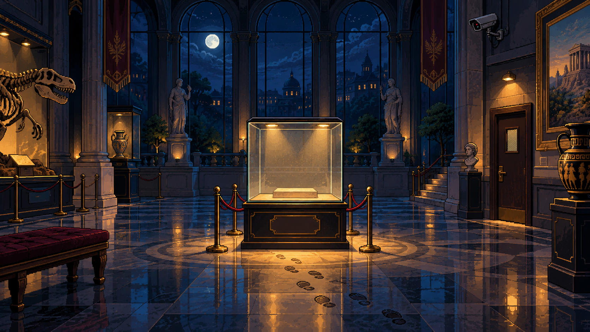

# Музейный детектив

Небольшая детективная игра на Python: изучайте улики, наблюдайте, как по
формуле Байеса меняются вероятности, и назовите похитителя музейного
артефакта.



## Что уже работает

- три подозреваемых с отдельными портретами;
- четыре улики и пересчёт вероятностей после каждой новой группы свидетельств;
- защита от повторного учёта зависимых улик;
- графический интерфейс на Tkinter и терминальная версия;
- девять unit-тестов для игровой логики.

## Запуск

Нужен Python 3.10+ с Tkinter. Сторонние библиотеки не требуются.

Графическая версия:

```bash
python3 gui.py
```

Терминальная версия:

```bash
python3 main.py
```

Тесты:

```bash
python3 -m unittest -v
```

## Как устроено расследование

У каждого подозреваемого есть начальная вероятность. После изучения улики
игра умножает её на правдоподобие этой улики для каждого подозреваемого и
нормализует результат:

```text
P(подозреваемый | улика) ∝
P(подозреваемый) × P(улика | подозреваемый)
```

Камера и датчик движения относятся к одной группе свидетельств, поэтому не
усиливают друг друга повторно.

## Структура

```text
.
├── assets/       # фон, портреты подозреваемых и набор улик
├── gui.py        # графический интерфейс
├── main.py       # игровая логика и терминальный режим
└── test_game.py  # тесты
```

Графика создана с помощью OpenAI ImageGen. Подробности и краткие описания
промптов находятся в [`assets/README.md`](assets/README.md).

Короткое видео о проекте: [YouTube Shorts](https://youtube.com/shorts/bSMMiQpyDJw).

